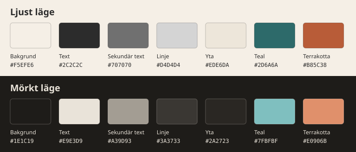

# Grafisk profil

GestaltaDets utseende på sajten: gestaltadet.se med katalogen under `/katalog/`. Värdena står i `grafisk-profil.css` bredvid den här sidan, och den filen är den enda källan: sidan förklarar, stilmallen gäller. Profilen beslutades 2026-11-01 i en grillning (#15), med den tidigare profilen för GestaltaDets första sajt som utgångspunkt; det av den som gäller sajten står här, det som gäller diagram står kvar hos upphovspersonen tills interlingua kan ta emot det.

## Ledord: signifikant enkelhet

GestaltaDet är personligt men precist: en människa med en röst, inte en byrå med ett uttryck. Designen ska inte konkurrera med innehållet; begreppen, tabellerna och ritningarna är hjärtat. Varje visuellt val ska ha ett syfte, och allt som inte förmedlar något tas bort, på samma sätt som ett diagram med hög data-ink ratio. Det som är på samma nivå ska se likadant ut, det som är på olika nivåer ska se märkbart olika ut.

## Omfång

Profilen gäller sajtens sidor: katalogen, startsidan och det som kommer runt dem. Katalogens bilder ritas av interlingua, och hur de ser ut (pilar, färger, första intrycket) är interlinguas ärenden [#914](https://github.com/nickdin/interlingua/issues/914) och [#916](https://github.com/nickdin/interlingua/issues/916). Diagramkonventionerna, tunna kolgrå linjer, form och placering före färg, läggs till här när bilderna kan styras.

## Färgerna

En begränsad palett: varm nog att kännas personlig, återhållsam nog att inte störa ritningarna. Sajten följer läsarens inställning för ljust eller mörkt läge; det mörka byter bara värdena, rollerna är desamma, och tonerna är varma i båda så att det känns som samma sajt.

| Roll | Ljust | Mörkt | Används för |
| --- | --- | --- | --- |
| Bakgrund | `#F5EFE6` varm sand | `#1E1C19` varmt mörkgrå | sidans yta |
| Text | `#2C2C2C` kolgrå | `#E9E3D9` varmt benvit | löptext; aldrig rent svart eller rent vitt |
| Sekundär text | `#707070` | `#A39D93` | förklaringar, etiketter |
| Linje | `#D4D4D4` | `#3A3733` | tunna gränser, tabellinjer |
| Yta | `#EDE6DA` | `#2A2723` | kodrutor och andra avgränsade ytor |
| Teal, primär | `#2D6A6A` | `#7FBFBF` | ordmärket, rubriker, länkar |
| Terrakotta, accent | `#B85C38` | `#E0906B` | det enda som ska stå ut |

Teal är primärfärgen: analytisk klarhet utan att vara korporativt blå. Terrakotta används sparsamt och avsiktligt, aldrig på mer än ett fåtal element samtidigt; på sidan bär den bara den sida läsaren är på i sidhuvudet. Den ljusa ytan är sand ett steg mörkare, inte den tidigare profilens neutralgrå `#F0F0F0`, som var ritad för vit bakgrund.

Kontrasten är mätt med den formel webbläsare och tillgänglighetsreglerna (WCAG) använder, där text behöver 4,5 mot sin bakgrund. I ljust läge klarar text (12,2), sekundär text (4,3, godtagbar för stor eller sekundär text) och teal (5,4) kravet, men terrakotta (4,0) och den tidigare profilens ljusare teal `#4A9494` (3,1) gör det inte: de är accentfärger för linjer och ytor, inte textfärger på sand. I mörkt läge klarar alla fyra kravet (6,3 till 13,3).

## Typsnitt

Systemtypsnittet: det läsaren redan har, San Francisco på iPhone och Mac, Segoe på Windows, Roboto på Android. Den tidigare profilen valde Inter, men Inter finns inte på läsarens dator och måste levereras, antingen från en tredje part vid varje sidvisning eller som filer sajten själv bär, och det senare kräver att interlingua kopierar med dem. Systemtypsnittet kostar ingenting och följer ledordet. Vill GestaltaDet ha Inter senare är det ett ärende i interlingua först.

Rubriker skrivs med vanliga gemener och versaler, aldrig enbart versaler, i halvfet vikt. Fetstil reserveras för att styra blicken; kursiv för ett begrepp i teknisk bemärkelse och för främmande termer, som EDGY:s *journey*.

## Måtten

- Brödtext 17 px (`1.0625rem`), radavstånd 1,6.
- Spalten är interlinguas, 52 rem, drygt 800 px, eftersom katalogens tabeller och bilder behöver bredden. Ren prosa blir något bred i den, så startsidan sätter 36 rem, drygt 600 px, i sin egen sida (#16); värdet flyttar hit när en sida till behöver det.
- Länkar understrukna, i teal.
- Rundade hörn på rutor, 4 till 6 px.
- En sidas huvudingång, som startsidans *Öppna katalogen*, är en länk i en ram: teal, 2 px, rundade hörn 6 px, halvfet text utan understrykning. Det är det enda på en sida som får se annorlunda ut än text, och en sida har högst en.

## Ordmärket

**GestaltaDet** skrivs i ett ord med G och D versala. Logotypen är ordmärket i halvfet teal, utan understrykning, i sidhuvudet; ingen symbol i startfasen, namnet bär sig självt. En ikon är ett eget ärende (#17): en illustration vid sidan av ordmärket, och flikikonen, den lilla bilden i webbläsarens flik, väntar på den.

## Gränsen mot interlingua

Profilen sätter färgerna, textens storlek och radavstånd, länkfärgen, rubrikerna, sidhuvudets ordmärke och accenten för sidan läsaren är på. Allt annat, tabeller, listor, formulär, bildvisning, är interlinguas sida som den är, så att interlinguas förbättringar kommer katalogen till godo utan att profilen ändras. Stilmallen ska vara kort, och ett värde som inte gör skillnad för GestaltaDet står inte i den.

## Hur profilen når sidorna

`settings.yaml` pekar på stilmallen med nyckeln `theme` ([interlingua #915](https://github.com/nickdin/interlingua/issues/915), inkopplad i #18). interlinguas `publish` skriver stilmallen som `katalog/static/theme.css` och länkar den efter interlinguas egen, `page.css`, på varje sida. Läsarens webbläsare läser dem i den ordningen, så profilen vinner där båda säger något. Startsidan (#16) och ritningssidan länkar samma två filer, så utseendet finns i ett exemplar.

Stilmallen sätter i första hand interlinguas egna variabler, som `--color-text` och `--font-size`, från profilens värden. Då byter katalogen utseende utan att interlinguas regler skrivs om. Egna regler har stilmallen bara för det variablerna inte når: rubrikernas färg, ordmärket, versionsväljarens etikett, kryssrutelistans ram och accenten.
